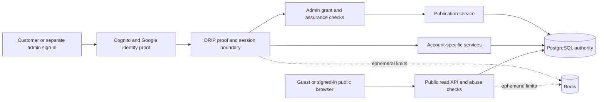

# P2-0 decision, threat-model and contract review package

**Current frontend-only sequencing amendment — 2026-10-26:** §16 authorizes the customer/admin/seller presentation package. Backend/authentication and P2-B gates remain unchanged; historical status statements below retain their original scope.

**Current procedure amendment — 2026-10-21 (subsequent owner approval):** §15 approves own-account invocation with reason/confirmation and recent authentication, separate suspension/notification outcomes, and reviewed restoration. Earlier amendments remain historical; technical choices and C1/D3 stay partially open, and authentication implementation remains paused.

**Current action-design amendment — 2026-10-21 (subsequent owner approval):** §14 records the dedicated Emergency Suspend Admin console action and notification to both founders. Earlier emergency-policy records remain historical; secure mechanics and partial-failure details remain for review, C1/D3 remain partially open, and authentication implementation stays paused.

**Current emergency-policy amendment — 2026-10-21 (subsequent owner approval):** §13 approves immediate protective suspension by either co-founder, other-founder approval for restoration and attributable emergency auditing. It supersedes the earlier pending-policy statements below; operational details and C1/D3 remain partially open, and authentication stays paused.

**Latest governance amendment — 2026-10-21 (subsequent Option A approval):** §12 records other-founder approval for routine administrator grants/privilege changes, with separate individual accounts. Emergency revocation remains an explicit pending procedure; C1 and D3 remain partially open and authentication stays paused.

**Latest scoped amendment — 2026-10-21 (subsequent decision):** §11 records the owner-approved local-development admin MFA exception and separate co-founder accounts. It qualifies earlier MFA wording only within the strict local boundary; C1 and D3 remain pending and authentication remains paused.

Date: 2026-10-20 (Asia/Calcutta). **Status: prepared for owner review; technical choices remain pending. Documentation only.**

**Current checkpoint — 2026-10-21 (Asia/Calcutta):** §10 records the owner's direction-level authentication approval under ADR 0002 §12. It supersedes conflicting October 20 proposals without rewriting their history. Customer MFA is not compulsory, linking is disabled initially and the seven-day customer maximum is hard; C1–C7 details and named D3 authorities remain pending. This package is not full P2-0 closure; authentication remains paused.

This is the bounded preparation package selected by the [P2-A readiness audit](p2-a-readiness-audit.md), not full P2-0 closure or P2-1 authorization to resume. C1–C7, D2–D5 and D7 remain unresolved. D6 is a P2-B-only dependency. No provider configuration, executable schema, fixture, test, migration or application behavior is created here.

## 1. Authority, notation and settled requirements

References below are shorthand for these reviewed sources. A requirement row cites its controlling section; a proposal does not become an approved requirement merely by appearing in a table or example.

| Reference | Authoritative source and relevant sections |
| --- | --- |
| A1 | [ADR 0001](adr/0001-modular-monolith-foundation.md), Decisions 1–5 and Status: modular monolith, PostgreSQL authority, exact money, React-free shared contracts, fail-closed configuration and approval history |
| A2 | [ADR 0002](adr/0002-cognito-authentication-decision.md), §§1–2 precedence/approved decisions; §§3–8 trust, tokens, sessions, recovery, linking, deletion/abuse; §9 C1–C7; §§10–11 evidence and review gates |
| P3 | [Phase 2 plan](phase-2-specification-and-plan.md), §3 “Customer behavior and eligibility”: Discover gestures, eligible variants, search and bounded discovery |
| P4 | Same plan, §4: catalog entities, immutable prices/publication, proposed identity records, local/server wishlist, guest transition and migration strategy |
| P5 | Same plan, §5: real catalog source approval, required admin workflow, optional CLI and deferred ingestion |
| P6 | Same plan, §6: public/private DTOs, endpoint contracts, bounds and error behavior |
| P7 | Same plan, §7: security and privacy requirements |
| P8 | Same plan, §8 P2-0 through P2-6 and dated readiness checkpoint: dependency order and implementation gates |
| P9 | Same plan, §9: required future tests and measurable acceptance |
| P10 | Same plan, §§10–11: settled decisions, D2–D7 inputs and approval checklist |
| S | [Setup](setup.md): runtime pins, environment convention, disposable target guards and clean-verification boundaries |

**Settled; not reopened:** Cognito; Google and email/password customer sign-in; no initial customer phone collection or routine SMS OTP; separate customer/admin authentication; approved strong MFA plus current DRIP-side grants for admins; seven-day customer session policy; verified-channel recovery; immediate DRIP disablement/revocation; private deletion within 30 days and minimal approved audit. Guests browse eligible public content without an account. Permanent wishlist saves and online cross-device refresh belong in P2-A and require authentication. Controlled admin publication supplies one shared real catalog. External retailer redirects are the sole initial purchase mode; hybrid modes remain a future architectural direction. No DRIP checkout/orders/payments/settlements, spreadsheet ingestion or AI feature is introduced. [A1; A2 §§1–2; P3–P5; P10]

**Labels used here:** “Baseline requirement” restates controlling rules; “baseline proposal” retains an existing unapproved technical choice; “new proposal” offers detail for this review; “inference” explains a consequence without asserting approval. All DTO examples remain proposed wire contracts until review and implementation. A2 governs where the plan's older OTP or unqualified session/pool wording conflicts with later amendments. [A2 §§1,9,11; P6 authentication amendment]

Foundation verification is closed, not repeated: [Gate B](gate-b-verification.md), [accepted disposable guard correction](disposable-target-guard-verification.md), [SDK alignment](expo-sdk-57-patch-alignment-verification.md), and [five-test live execution](docker-live-integration-readiness-verification.md). Their earlier failures and dated inventories remain historical. They do not establish identity-provider, native-device or product acceptance. [Readiness audit; P9]

## 2. Decision packet — no approvals inferred

Every row is **PENDING OWNER INPUT**. The project owner chooses or designates accountable operators; no person, supplier, AWS account, client, domain or device is invented. “Evidence” distinguishes a decision needed before design from later operational proof needed for acceptance. Sensitive values belong in approved protected configuration, not this document. [A2 §9; P10]

| ID / status | Exact choice requested and existing recommendation | Affected behavior / downstream gates | Evidence to close the decision and later demonstrate it |
| --- | --- | --- | --- |
| C1 — PENDING | Admin factor/assurance; enrollment; recent-MFA proof; lost-factor recovery/approvers; emergency process and session/freshness limits. Baseline proposes restricted local-admin TOTP, eight-hour sessions/15-minute freshness; neither durations nor TOTP adequacy are approved. Consider stronger phishing-resistant assurance if required. | P2-1 admin identity; P2-3 publication. Strong MFA and grants are settled, mechanism is not. | Owner-approved factor/recovery runbook, named authority via D3, demonstrated available assurance evidence; later real enrollment, factor loss, revocation and recovery tests. [A2 §§3,5–6,9] |
| C2 — PENDING | Google consent/project ownership, scopes/mapping, test/production publishing, Cognito domain, environment/client ownership and exact callback/logout allowlists. Baseline proposes managed code + PKCE; no invented callback is approved. | P2-1 proof/callback design; P2-5 mobile return path. | Reviewed environment/realm/client/callback matrix and minimal attributes; later both redirect legs, cancellation/replay and wrong-client tests in authorized environments. [A2 §§4,9] |
| C3 — PENDING | Enable explicit linking or stage it; collision handling, proof/confirmation, email normalization/protected index and existing-profile reconciliation. No automatic email merge is already mandatory. | P2-1 identity mapping/schema; later account and wishlist ownership. | Approved identity state transitions/index privacy rules; later two-profile, one-proof-only, concurrent-link and cancelled-confirmation evidence. No destructive merge. [A2 §§7,9] |
| C4 — PENDING | Seven-day absolute/idle semantics, fresh authentication, opaque session versus JWT bound to durable session, token custody/encryption, refresh/rotation, per-device/logout-all scope and external provider disable propagation. Absolute 168 hours and no renewal extension are baseline proposals. | P2-1 sessions/schema/authorization; all later protected writes. | Approved lifecycle and in-flight-request contract with enforceable external-change propagation; later clock boundaries, old JWT/SSO, outage, logout and immediate DRIP-block tests. [A2 §§5,9] |
| C5 — PENDING | AWS/environment ownership, region/residency, SES region/sender/domain/reply-to/DNS, sandbox exit, delivery/bounce/complaint operations and budget. Mumbai/SES is proposed, not configured. | P2-1 environment design and real-provider acceptance. | Named responsible owner, approved data-flow/delivery plan and secure configuration references; later actual test delivery/provider evidence. No claim of exclusive India residency. [A2 §§8–9] |
| C6 — PENDING | Password policy, verified-email change/recovery, customer MFA posture, Cognito tier/protections, quotas/cooldowns and spend ceilings. Baseline suggests managed login and verified-email recovery; no phone fallback. | P2-1 identity abuse/recovery; P2-4 public browsing controls. | Approved endpoint/provider abuse matrix including shared-IP users and direct Cognito access; later enumeration, limiter-failure and recovery tests. Exact public 60/minute/burst-10 figures remain proposed. [A2 §§6,8–9; P6] |
| C7 — PENDING | Minimum audit fields/retention, deletion suppression/retries, backup expiry/restoration, deadline measurement, exceptions and escalation. Do not reuse catalog's proposed retention for identities. | P2-1 privacy/persistence; later wishlist deletion and pseudonymous operator audit. | Approved data/retention table and deletion runbook; later provider-failure retries, restore suppression, deadline and redaction evidence. Thirty-day target and immediate denial are settled. [A2 §§8–9] |
| D2 — PENDING | Exact pilot audience/cohort, approved brands/categories, size/color vocabulary and price sanity ceiling. Adult clothing/narrow taxonomy/two brands are baseline recommendations, not partners selected. | P2-2 validation/catalog; P2-4 filters and real-data acceptance. | Owner-approved vocabulary/ceiling and real supply inventory with D3 rights; sufficient same-category/different-brand examples for acceptance, never invented supply. [P3; P10] |
| D3 — PENDING | Named admin/grant/rights approvers, approved catalog and image sources/hosts, rights conditions, branding assets. | Named grant authority blocks P2-1; source rights block P2-2/P2-3; artwork/native presentation affects P2-5. | Signed-off authority matrix, protected license/approval references and exact hosts, reviewed assets. A reachable URL is not rights evidence. [P4–P5; P8 checkpoint; P10] |
| D4 — PENDING | Actual merchant destinations, host policy and link-out disclosure. External-link capability is already approved. | P2-2/P2-3 publication; P2-4/P2-5 public link action. | Approved destination/merchant/host list and disclosure; later unsafe URL and withheld-destination tests. Missing approval means no public URL/action. [P6; P10] |
| D5 — PENDING | Freshness interval, observation/refresh operations owner and source/approval retention. Seven-day price age and 90 days after withdrawal are proposals only. | P2-2 publication and price history; P2-4 eligibility. | Approved observation/expiry/refresh policy, clock tolerance and source retention schedule; later boundary/revocation/no-fallback tests. Clock tolerance is technical detail required by PriceRecord, not an assumed owner decision. [P4 PriceRecord; P10] |
| D7 — PENDING | Native Android/iOS device/simulator, build/signing access, pilot audience and distribution scope. | P2-1/P2-5/P2-6 native/provider acceptance; not a blocker to this document or offline test design. | Approved access/ownership and release-build test plan; later actual native and second-device results. Export alone is insufficient; paid/cloud/store actions need authorization. [P8; P9–P10] |
| D6 — PENDING, P2-B ONLY | Editorial owner, licensed content/sources, detailed presentation and release sequencing. OOTD inclusion and guest access are settled. | P2-B after P2-A acceptance and separate authorization; not P2-A closure. | Later editorial/source approval and separate outfit contract/native evidence. No outfit DTO/schema is added by this package. [P8 P2-B; P10] |

Suggested decision-record format for owner review (new documentation proposal): `decision ID; selected option; rejected alternatives/trade-off; accountable owner; approval date/reference; approved operational evidence location; remaining acceptance evidence`. A decision can be resolved before live acceptance evidence exists, but that evidence must remain explicitly outstanding. No row above is resolved by this document.

## 3. Trust boundaries and failure expectations

The diagram expresses responsibilities, not a chosen deployment or Cognito pool topology. Pool/client details remain C1/C2/C5; session topology remains C4. “Identity service” is a future module, not existing code. [A1; A2 §§3–5; P4]

| Boundary / assets | Threat or negative case | Baseline required outcome and pending mechanics |
| --- | --- | --- |
| Public browsing → read service | Guest supplies account ID, requests hidden IDs, replays old cursor, or sends an admin field | Public serializers expose only eligible fields; private/admin endpoints enforce authentication/authorization independently. Unknown and unpublished products are indistinguishable 404; selection/cursor never confers identity. Recheck eligibility on every read. [P3; P6–P7; A2 §2] |
| Provider → DRIP proof validation | Wrong issuer/client/purpose/algorithm/signature, untrusted key URL, unknown key, expired/future proof, raw Google/ID token used as API credential, replay or unverified email | Reject without creating a session or selecting a principal from client input. Exact configured realm/client, verified proof and email, bounded key refresh; fail closed. State/nonce/PKCE details belong to the proposed C2/C4 flow, not an implemented guarantee. [A2 §§3–4,10] |
| Customer → privileged admin | Matching email/group, client-set admin flag, customer token against admin routes, stale/revoked grant | Customer proof cannot establish admin authority. Separate approved admin authentication plus current DRIP grant and proven required assurance; deny self-grant. Named provision/revoke authority is D3, recent-MFA evidence C1/C4. [A2 §§3,5–6; P5–P6] |
| Session → PostgreSQL authorization | Signed JWT remains valid after DRIP disable/delete; cached grant grants access; concurrent revoke/write | PostgreSQL status/grant/session is authoritative; subsequent protected checks reject after the block commits, sensitive writes recheck before commit. C4 specifies handling of in-flight work and provider-side changes; do not promise already completed work is undone. [A2 §5; P4 identity] |
| Client storage/logs → secrets | Raw password/code/refresh token in logs, browser bundle, URL, catalog record or unencrypted cache | No DRIP password/code storage; secret custody uses the approved mechanism. Proposed opaque handles are hashed, retained provider credentials require C4 encryption/key management; native secure storage and secure cookie/CSRF design are reviewed before use. No secrets in public environment variables. [A2 §§5–8; P7; S] |
| Rate limiter → public/identity access | Redis unavailable; bot bypasses API via Cognito; provider outage misclassified as permission to skip checks | Limiter failure denies affected requests with safe 503, not unlimited access. Cognito-facing protections need separate C6 policy/evidence. Healthy public catalog remains usable during login-provider outage; private access never falls back to guest authority. Redis loss cannot create durable truth. [A1; A2 §8; P6–P7] |
| Operator → publication | Forged actor/approval, changed preview, stale revision, retry after response loss, mixed merchant keys | Verify grant and assurance before action; derive actor on server; bind preview to actor/environment/payload/revisions; all-or-nothing transaction and request-key/digest idempotency. Same key/different digest conflicts. No CLI bypass. [P4 CatalogPublication; P5–P6] |
| Catalog content → browser/network | Script/data URLs, private-IP link, embedded token, unsafe text, unlicensed image, malicious source alias | Exact approved HTTPS host policy, bounded plain text, no backend fetch/proxy, no HTML execution or fabricated fallback. D3/D4 approval needed; third-party image requests expose network metadata and retailer redirects retain external risk. [P5 step 4; P7] |
| Data lifecycle → backup/provider | Google-only re-login recreates deletion-pending account; provider delete fails; restored backup resurrects saves | Immediate DRIP denial, durable retry/suppression and honest pending status; private deletion within 30 days. C7 defines retained proof, backup replay/expiry and escalation. Cognito profile deletion is not Google-account deletion. [A2 §§7–8; P4 identity] |
| Tool/operator → deployment/database | Publisher chooses arbitrary environment, tests use user data, LLM executes database queries or computes authoritative prices | Test guard before connections, separate deployment-bound capabilities/roles, explicit production publication confirmation, no LLM database credentials/query executor or financial authority. New migrations after current head; no production destructive downgrade. [A1; P4 migration; P5–P7; S] |

Residual risks are not approvals: provider out-of-band disable propagation (C4), MFA recovery downgrade (C1), content rights and third-party redirects (D3/D4), stale manual price supply (D5), and incomplete native/provider access (C5/D7). Their dependent gates stay closed; mocks, JWT signatures and successful exports cannot substitute for required evidence. [A2 §§5–11; P8–P10]

## 4. Contract review examples

These are documentation fragments and shape notation, not executable schemas, fixtures, seed data or API responses claimed to exist. Symbols such as `PRODUCT_ID`, `ISO_UTC` and `APPROVED_IMAGE_URL` denote future validated values; they are deliberately not invented UUIDs, products, domains, customers or provider IDs. Numeric examples demonstrate representation only. [P4–P6; current task scope]

### 4.1 Exact money, timestamps and nullable inventory

Baseline: positive integer paise in PostgreSQL BIGINT, currency exactly `INR`, JSON decimal digit string, integer/string formatting only. PostgreSQL BIGINT's positive bound is **9223372036854775807**; D2's business ceiling remains pending and may be much lower. Zero/negative prices, float/JSON-number inputs, exponent notation, decimal paise, NaN and other currencies are rejected. An offline rupee conversion uses exact Decimal and rejects more than two fractional digits rather than rounding. [A1 decision 3; P4 common rules/PriceRecord; P5 step 3; P6 MoneyINR; PostgreSQL source in §7]

| Documentation value | Interpretation / planned assertion |
| --- | --- |
| `{"currency":"INR","amount_minor":"12345"}` | Representation-only example: exactly 123 rupees and 45 paise; no product or observed price asserted. |
| `"9007199254740993"` | Above JavaScript's safe-integer range; preserve every digit across Python/DB/JSON/TS. Do not convert to Number. This is a serialization case, not approval to publish a price above D2's ceiling. |
| `"9223372036854775807"` / `"9223372036854775808"` | Representational upper bound / overflow rejected. Publication applies the separate D2 ceiling even for representable integers. |
| `"0"`, `"-1"`, `"12.34"`, `"1e3"`, `12345` | Invalid price inputs under baseline rules. |
| `"00123"`, `"+123"`, `" 123 "`, non-ASCII digits | **New proposal for review:** require canonical ASCII `[1-9][0-9]*` strings and reject these alternate forms rather than silently normalize monetary input. Baseline says base-10 digit string; it does not explicitly settle all canonicalization details. |

UTC timestamp fields remain ISO strings corresponding to `timestamptz`; concrete formatting precision, canonical string handling and expiry-boundary equality are details to freeze in contract review. **New proposal:** `observed_at <= now < valid_until` with equality at expiry stale, and canonical UTC output ending in `Z`; do not claim this boundary/format has already been accepted. Clock-tolerance allowance and freshness policy require D5 review. [P4 PriceRecord; P6 Price]

`inventory: null` always means **unknown**, never zero, in-stock, a reservation, a quantity or a disabled-product inference. No inventory table/feed or availability filter is introduced in P2-A/P2-B. Size/color may be null; unknown size cannot satisfy a size filter, and one-size requires source evidence. [P3; P4 ListingVariant/Later entities; P6]

### 4.2 Public DTOs and access

The following shapes retain P6's proposed field vocabulary; IDs are strings of validated UUIDs when implemented. Guest and signed-in calls get the same public DTO, with private wishlist state obtained separately. Public shape allowlists exclude account/contact/provider subject, session/hash/assurance, grants, internal status/revisions, source/approval/audit data and wishlist membership. Not returning a field is a serializer requirement, not a TypeScript-only safeguard. [P6; P7; A2 §2]

| Proposed shape | Fields and semantics for review |
| --- | --- |
| `Price` | `{money:MoneyINR, observed_at:ISO_UTC, valid_until:ISO_UTC}`. Observations come from approved source evidence, never request time fabricated as freshness. |
| `ProductCard` | `{id,brand:{id,name},title,category_code,image:{url,alt},representative:{listing_id,variant_id},price:Price,price_is_from:boolean,inventory:null}`. One canonical product; representative variant satisfies all bound filters, with lowest eligible price then listing/variant UUID tie-breaks. `price_is_from` discloses variation among eligible prices. |
| `ProductDetail` | `{id,brand,title,description,category_code,listings:[{id,merchant:{id,name},purchase_mode:"external_redirect",destination_url:null|string,variants:[{id,size_label:null|string,color_label:null|string,image,price:null|Price,price_state:"current"|"stale"|"missing",inventory:null}]}]}`. Bounded to 10 listings/100 active variants per product; no hidden parent/variant information. Unapproved D4 destination is null and has no action. |
| `DiscoveryPage` | `{items:ProductCard[],next_cursor:null|string,empty_reason:null|enum,catalog_as_of:ISO_UTC}`; zero or one card initially. Observation time is not a complete snapshot or stock guarantee. Exact `empty_reason` wire spellings remain to freeze; meanings are no eligible products/similar candidate/different brand or exhausted session. |
| `SavedResolution` | `{items:ProductCard[],unavailable_ids:UUID[]}`; only resolves requested public product IDs. Not a wishlist endpoint and no indication of who saved them. |
| Facets | `{brands:[{id,name}],categories:[{code,label}],colors:[{code,label}],sizes:[string]}` from eligible catalog only, deterministic and bounded. No stock counts; D2 chooses vocabularies. |

Price state is evaluated on the latest recorded price by `recorded_at/id` **before** testing publication/validity. No older-price fallback. [P4 PriceRecord; P6]

| Situation | Public result / proposed test oracle |
| --- | --- |
| Latest approved price currently valid and all parent/variant visibility rules satisfied | Current price may appear in detail; Discover still requires a same-variant match to every active filter. |
| Latest price expired | `price:null`, `price_state:"stale"` on an otherwise eligible detail; no Discover card without another eligible current variant. |
| No price, latest not yet valid, or latest publication revoked | `price:null`, `price_state:"missing"` if the detail remains eligible through other visible records. Never expose a revoked listing; revocation unpublishes affected listings. |
| All price records stale/missing but a published visible listing/active variant remains | Product detail can remain visible with unavailable prices; empty Discover rather than fallback data. |
| Archived product/brand, no visible listing/variant, or unknown ID | 404 without reason-specific hidden metadata; stored wishlist may retain only an unavailable reference. |

Public access contract from P6: `GET /catalog/facets`, `POST /discover`, `GET /catalog/products/{product_id}`, `GET /catalog/products?ids=...` require no customer account. Discovery POST is read-only, not a guest session or account. Initial queries and continuation are distinct; unknown/mixed fields rejected. Retain the baseline one-card/200-seen-ID protocol and recheck visibility. Bound search to 80 Unicode characters, filter arrays to 10 values, normalized filter/search content to 2 KiB, JSON body to 32 KiB and encoded cursor to 24 KiB; cursor purpose/filter/anchor binding and 15-minute expiry are baseline technical proposals to validate before implementation. No raw query/body/cursor logging. Facet bounds (50 brands/20 categories/30 colors/100 sizes) and resolution cap (50 unique IDs) need boundary tests. [P3; P6 endpoint specifications]

### 4.3 Private and privileged shapes

| Proposed contract | Example shape / authorization and privacy rules |
| --- | --- |
| `GET /auth/me` | **New minimal shape proposal:** `{account:{id,status},session:{expires_at}}`, only for the authenticated active account; C4 may change session-summary fields. No email, phone, issuer, subject, token, hash or grant internals. Exact auth start/callback/exchange routes, cookies/headers and token fields remain pending C1–C4. |
| `GET /wishlist` | `{items:[{product_id,saved_at,product:ProductCard|null,availability:"visible"|"unavailable"}],refreshed_at:ISO_UTC}`; maximum 200, newest saved time/product ID first. Account comes exclusively from validated session, not request account ID. Unavailable entries carry no hidden title/image/merchant or reason. |
| `PUT /wishlist/items/{product_id}` | Empty intent beyond the target ID; proposed success body `{product_id,saved_at}`, 200 only after committed save. Repeated add is idempotent; eligibility checked on backend; cap 409 with no eviction. This instantiates P6's “saved ID/time” response, not a new route. |
| `DELETE /wishlist/items/{product_id}` / `DELETE /wishlist` | 204 after authenticated removal/explicit clear; absent item removal remains 204. Account serialization and database commit order govern concurrent operations; no offline replay. |
| `POST /auth/logout` / `DELETE /auth/account` | Baseline 204 logout; 202 deletion request after recent reauthentication and confirmation. **New status-shape proposal:** `{status:"deletion_pending"}`; exact contract pending C4/C7. Acknowledgement is not completed deletion; access is denied immediately. |
| Admin preview/publication | P6 preview `{digest,expires_at,expected_revisions,changes,errors}`; signed token transport and safe change/error DTO details require review. Publication returns receipt ID/status/counts, 201 first apply/200 same retry; server derives actor and verifies approval. No credentials/license documents/raw source payload in response. Current grant plus required strong/recent session and cookie-CSRF controls apply. |

All private responses use `Cache-Control: no-store`; discovery also uses no-store under P6. Public saved indicators, where displayed to a signed-in user, are an account-private client overlay after authenticated wishlist retrieval, never part of a shared public response. This overlay separation is an **inference** reconciling P3's saved-indicator behavior with P6/A2's public-field exclusion; exact UI remains to review. [P3; P4 wishlist; P6; A2 §2]

Authorization tests must cover guest → private 401, missing/expired/revoked session → 401, customer → admin 403, and no cross-account read/write by path/body/header/cached ID substitution. UUIDv7 or matching email never supplies authority. Own-account unavailable saved IDs do not authorize reading withdrawn data. [P6–P7; A2 §§2–3,7]

### 4.4 Safe error contract

Use the established envelope `{code,message,details,timestamp}` with safe `loc/msg/type` validation details. Documentation fragment: `{code:"VALIDATION_ERROR", message:"The request payload failed schema validation.", details:[{loc:["body","amount_minor"],msg:"Invalid value",type:VALIDATION_CATEGORY}], timestamp:ISO_UTC}`. Symbolic values are not executable JSON. Source inspection confirms this envelope in `apps/api/src/drip/core/errors.py`; future domain messages must be fixed/safe rather than reflect arbitrary inputs. [P6–P7]

| HTTP result | Expected distinction, not an implementation claim |
| --- | --- |
| 200 empty / 404 / 405 | Empty discovery is 200 with reason; unknown/unpublished product 404 indistinguishably; unsupported method preserves safe envelope/Allow semantics. Existing foundation handler behavior remains unchanged. |
| 401 / 403 | Missing/expired/revoked identity versus insufficient current privilege; no account existence or secret diagnostics. |
| 409 | Stale revision, request-key conflict, wishlist cap or discovery reset; no silent overwrite/eviction/filter relaxation. |
| 413 / 415 / 422 | Oversized body, unsupported media type, malformed inputs/filters/cursor; safe field locations, no raw values. |
| 429 / 503 / 500 | Throttled with Retry-After; dependency/limiter unavailable fails closed; redacted unexpected error. No exception text, SQL, URL credentials, tokens or stack traces in response/logs. |

Code strings already specified by P6 include `INVALID_CURSOR`, `CURSOR_EXPIRED`, `DISCOVERY_RESET_REQUIRED`; other new domain codes/messages are review details, not invented accepted enums. Provider error mapping must preserve approved recovery/enumeration protections and must not claim every upstream path is non-enumerating without tests. [P6; A2 §8]

## 5. Source approval and state-transition review

### Source approval packet

This is a proposed **blank review template**, not real catalog data or a persisted schema. For every intended source/publication, collect: designated approver/operator reference (pending D3), merchant/brand association approval, protected source/license reference and digest, allowed images/destinations and rights conditions, source observation/variant identifiers, tax-inclusive INR-price evidence, refresh owner/policy, expected revisions, preview digest and confirmed publication receipt. Do not paste raw license documents, personal identifiers, credentials or tokenized URLs here. D2–D5 supply actual values. [P4 provenance; P5]

Baseline workflow: permissioned real source → bounded admin editing → validation/preview (zero writes) → explicit confirmation of exact content/revisions/environment → authorized atomic apply → receipt. Invalid data reports safe structured field/source-key errors and rejects the whole change set. Same-key/same-digest retry returns the existing receipt after authorization; changed digest conflicts. Revocation checks newer revisions and conservatively removes visibility; shared brand/product incidents require cross-merchant review/quarantine, never stale before-image overwrite. Optional CLI is the same service under operator authorization, not a substitute for the admin UI. No spreadsheet upload, source scraping, seeded production fallback or pilot data in migrations. [P4 CatalogPublication; P5–P7]

### Guest-to-confirmed-save state machine

Every row restates the approved transition in P4 “Guest browsing and transition” and A2 §2; the state labels are descriptive, not new persisted fields.

| State/event | Allowed action / observable result | Forbidden shortcut |
| --- | --- | --- |
| Guest card → right/save | Keep current public card/ID and pending intent in transient memory; prompt sign-in | No wishlist write, account-specific guest session, successful-save badge or deck advance |
| Sign-in cancelled/failed | Return to preserved card; no write; restart may discard transient intent | No durable pending-save queue or account creation as a save side effect |
| Sign-in succeeds | Show intended product/account and require explicit confirmation | Login itself cannot save or merge another account's cache |
| Confirmation declined / account changes | No write; keep a safe card state and establish confirmation for the intended current account | No replay of prior account confirmation |
| Confirmed save in flight | Backend validates current session/account and product eligibility; UI waits | No optimistic claim of permanent persistence or duplicate in-flight gesture |
| Backend commits and acknowledges | Display saved state, then ordinary next discovery; future second-device refresh reads PostgreSQL | Local cache cannot establish success or cross-device sync |
| Timeout/rejection/revocation/withdrawal | Keep retry/unavailable state; no success or automatic advance. Retry uses idempotent endpoint; recheck authorization/eligibility | A timeout is not proof of rollback; no false “not saved” claim if acknowledgement was lost |

The last timeout clarification is an **inference** from idempotent retries/backend acknowledgement in P6: uncertain outcome is reconciled online, not resolved by a local authoritative write.

Wishlist privacy/lifecycle: per-account optional cache only, cleared on logout/switch/deletion; online refresh on foreground/open/explicit action; no queued offline mutations or realtime guarantee. Catalog archive preserves association but suppresses hidden content. Deletion immediately denies access, removes private associations within the approved target, retries provider operations and prevents deletion-pending recreation. Minimum C7 audit/suppression retention is distinct from D5 catalog evidence; no cascade deletion of shared catalog caused by account deletion. [P4 identity/wishlist; A2 §§7–8]

## 6. Future acceptance matrix

**All rows below are NOT RUN for Phase 2.** U = unit, A = API, C = cross-language/serialization contract, I = isolated PostgreSQL/Redis integration, W = web UI, M = mobile component/state tests, N = real native/provider evidence. Proposed test-group names describe future work, not files created or scripts installed. Sources identify the normative requirement; implementation-dependent choices stay gated.

| ID / requirement and source | Future test group, levels and measurable evidence | Gate / unresolved input |
| --- | --- | --- |
| T01 — production fail-closed configuration and safe HTTP/logging (A1; P7) | `identity_configuration`, U/A: wrong environment/issuer/client, missing required settings, unsafe secret/log settings fail before exposing auth; errors contain no supplied secrets. Retain foundation regressions. | P2-1; C1–C7 contract |
| T02 — verified identity/realm/proof (A2 §§3–4,10) | `identity_proof`, U/A/C: signature/algorithm/key/issuer/client/token-use/scope/time/nonce/state/PKCE/replay negatives; raw Google/ID-token misuse; valid approved proof path; unverified email denied. | P2-1; C2/C4/C6 |
| T03 — Google/email-password, no phone (A2 §§2,6,10) | `identity_real_flows`, W/M/N: both actual methods, verified email and recovery, cancellation, no phone in UI/scopes/mapping/storage; real authorized delivery. Mocks labelled logic-only. | P2-1 acceptance; C2/C5/C6/D7 |
| T04 — strong admin MFA and current grants (A2 §§3,5–6) | `admin_authority`, U/A/I/W/N: same email/group/customer proof cannot escalate; no self-grant; actual recent-factor evidence, lost-factor/emergency path, revoke during write. | P2-1/P2-3; C1/C4/D3 |
| T05 — seven-day/session/revocation (A2 §5) | `session_lifecycle`, U/A/I/N: before/at/after approved deadline, refresh/SSO behavior, two devices, logout scope, already-issued JWT after DRIP block, external provider change and outage. No-extension oracle conditional on approved absolute-expiry choice. | P2-1; C4 |
| T06 — linking/collision privacy (A2 §7) | `identity_collision`, U/A/I/W/N: same email no merge; one proof insufficient; two existing profiles, concurrent linking, cancelled confirmation; stable account/save/grant ownership. Test approved staged-linking denial if linking disabled. | P2-1; C3/C7 |
| T07 — deletion within 30 days/minimal retention (A2 §8; P4) | `deletion_lifecycle`, U/A/I/N: immediate denial, provider outage retry, suppression, backup restore, no shared-content cascade; controlled-clock deadline tests plus approved operational measurement/runbook evidence, no claimed 30-day elapsed run from a clock mock. | P2-1/P2-4; C4/C7 |
| T08 — public/private separation (P6–P7; A2 §2) | `public_projection`, A/C/I: guests and customers receive identical eligible public fields; no hidden/audit/account/wishlist data; 401/403 boundaries; public ID resolution not wishlist enumeration. | P2-4; P2-1–P2-3 prerequisites |
| T09 — anonymous/provider abuse (P6–P7; A2 §8) | `abuse_boundaries`, U/A/I/N: exact approved quotas, shared-IP legitimate use, generic errors, Retry-After, Redis failure 503, direct provider path protections; healthy public reads survive login outage. | P2-1/P2-4; C6 |
| T10 — exact money/bounds (A1; P4–P6; P9) | `money_contract`, U/C/I: integer/string-only parse/display; >JS-safe precision; BIGINT overflow, invalid currency/float/zero/negative/exponent; D2 ceiling; canonicalization proposal only after review. | P2-2/P2-4; D2 |
| T11 — latest-price/no fallback (P4 PriceRecord; P6) | `price_visibility`, U/A/C/I: newer expired/revoked/not-yet-valid record never falls back; before/at/after chosen boundaries; detail null state vs Discover exclusion; missing destination action suppressed. | P2-2/P2-4; D4/D5 |
| T12 — variant/unknown-inventory integrity (P3–P4) | `variant_integrity`, U/A/C/I: same variant satisfies size/color/price; null size cannot match; source-only one-size; duplicate SKUs/source mapping conflicts; no quantity/in-stock inference, cross-product variant rejected. | P2-2/P2-4; D2/D3 |
| T13 — source/URL/rights and real data (P4–P5; P7) | `source_validation`, U/A/I/W: unapproved rights/host/unsafe scheme/IP/userinfo/token/plain-text failures; image error honest; real approved sample through admin and mobile; no synthetic production fallback or implicit row deletion. | P2-2/P2-3/P2-5; D2–D5 |
| T14 — atomic publication/retry/revoke (P4–P6) | `publication_transactions`, U/A/I/W: preview zero writes, invalid/stale apply zero writes, parallel same-key one receipt, different digest 409, server actor, CSRF, revoked grant, stale revoke conflict and shared-content quarantine. | P2-2/P2-3; P2-1, D3–D5 |
| T15 — public discovery protocol (P3; P6) | `discovery_protocol`, U/A/C/I/M: left category/color ranking, up different brand, all filters intersect, tampered/mixed/expired cursor, hidden anchor reset, one-card serial chain up to 200 IDs, empty reasons, replay/client dedupe and stale-request cancellation; no relaxed filters. | P2-4/P2-5; D2/C6 |
| T16 — endpoint bounds/error parity (P6–P7) | `api_contract`, U/A/C: facet/detail/query/ID/body/cursor limits, unknown fields, search wildcard escaping; 404/405/409/413/415/422/429/503/redacted500; legitimate max cursor fits; no logging of values/body/cursor. | P2-4; C6/pending wire details |
| T17 — account-private saves and races (P4; P6) | `wishlist_persistence`, U/A/I: two-account read/write isolation, 200-cap/clear/add races, commit ordering, idempotent add/remove, archive retained but unavailable, owner-only deletion. | P2-4; account + catalog FKs |
| T18 — guest confirmation/acknowledgement (P4; A2 §2) | `guest_save_transition`, A/M/N: every state in §5, cancellation/switch/restart, no pre-confirm write, no guest persistence, timeout/retry/no false success, withdrawn content suppressed. | P2-5; P2-1/P2-4/C2/D7 |
| T19 — online cross-device/cache (P4; P9) | `wishlist_sync`, I/M/N: same account second device sees save/remove/clear on refresh; other account cannot; cache clears on switch/logout/delete, no offline mutation replay or stale price labelled current. | P2-5/P2-6; D7 |
| T20 — admin shared catalog UX (P5; P9) | `admin_publication_ui`, W/I/N: actual approved operator previews/publishes/updates/withdraws real licensed content; shared mobile reads same resulting catalog; CLI alone insufficient. | P2-3/P2-6; C1/C4/D2–D5 |
| T21 — native/accessibility (P3; P8 P2-5; P9) | `mobile_acceptance`, M/N: branded release splash, exact gestures and button/screen-reader parity, reduced motion, rapid actions, detail scrolling, image/offline/retry/empty states on Android/iOS. | P2-5/P2-6; D3/D7 |
| T22 — schema/migration safety (P4 migration; P9; S) | `persistence_migrations`, I: new revisions after then-current head, UUIDv7 and FK/unique/check tests, isolated upgrade/downgrade/re-upgrade and rollback, preserve historical revisions and populated data; no pilot seed migrations. | Each schema milestone; no schema work now |
| T23 — reproducibility/module boundaries (A1; P9; S) | Fresh-source frozen/locked installs, shared build/type contracts, backend/UI/contract tests, Ruff/Mypy/lint/build/Expo/export; record real exits/counts/unchanged locks and unavailable checks. Shared types stay React-free. | P2-6; future runner wiring |
| T24 — performance and query budget (P9) | `catalog_performance`, I: proposed <=1,000 products/5,000 variants, 10 clients/1,000 post-warm-up requests, p95 <=500 ms, <=5 queries, no variant N+1. Record environment/dataset; targets remain baseline proposals, no fabricated measurements. | P2-4/P2-6; authorized staging/data |
| T25 — P2-A end-to-end acceptance (P8 P2-6; P9) | W/I/N: real admin → publication → guest browse/link → sign-in + explicit confirm → acknowledged save → second-device refresh, plus privacy/deletion evidence. Explicit owner acceptance after evidence. | P2-6; all preceding applicable gates |
| T26 — OOTD boundary, not P2-A acceptance (A2 §2/10; P8 P2-B) | Future only: guest eligible rights-cleared outfits, whole-outfit suppression on any required ineligible product/content, public/private parity, native tests. No current OOTD files or fixtures. | P2-B only; D6/D7 and separate authorization |

## 7. Testing-tool options and future commands

### Observed repository capabilities

Inspection, not execution: Node 24.19.0/pnpm 9.15.9/Python 3.14.7 pins; locked pytest/pytest-asyncio/HTTPX, Ruff and Mypy; TypeScript 6.0.3; mobile Expo 57.0.30/React 19.2.3/RN 0.86.3; web Next 16.4.0/React 19.3.0. Root `pnpm test` runs backend tests with the existing non-live default. No declared `test:mobile`, `test:web` or `test:contracts` scripts exist. Mobile/web workspaces have no declared behavior runner; shared-types has build/type-check only. Installed transitive packages do not establish usable test suites. [Root/workspace manifests; API pyproject; S]

### Official sources and compatibility assessment — reviewed 2026-10-20

This is a **proposal**, not verified installation compatibility. Mobile SDK stays 57; web/mobile React versions remain separately scoped. No renderer overrides, framework upgrades, dependency installation or lockfile edits are authorized here. Exact versions and peer graphs must be resolved and recorded in a later authorized tooling change. [S; P8 P2-0; P9]

| Layer | Recommended option / alternative | Evidence and limits |
| --- | --- | --- |
| Backend unit/API/integration | Retain locked pytest + pytest-asyncio + HTTPX and existing guarded fixtures | Already declared; no replacement needed. New behavior gets focused tests; existing tests are foundation evidence only. [API pyproject; P9; S] |
| Mobile logic/components | Jest + SDK-matched `jest-expo` + React Native Testing Library | [Expo Jest guide](https://docs.expo.dev/develop/unit-testing/) documents this approach and pnpm transforms. Installed SDK compatibility map lists `jest-expo: ~57.0.6`; it is a candidate range, not newly installed. [Expo SDK 57 reference](https://docs.expo.dev/versions/v57.0.0/) anchors the SDK. |
| Mobile renderer compatibility | Evaluate RNTL 14.x with its documented `test-renderer` peer | [RNTL 14 quick start](https://oss.callstack.com/react-native-testing-library/docs/start/quick-start) names `test-renderer`, distinct from deprecated `react-test-renderer`. Exact Jest/renderer/RNTL patches and RN 0.86.3/React 19.2.3 peers require resolution and a smoke test; no claim that choosing RNTL alone completes the graph. |
| Web unit/components | Vitest + React Testing Library/jsdom; alternative Jest with Next integration if peer review favors it | [Next Vitest guide](https://nextjs.org/docs/app/guides/testing/vitest) supports synchronous component/unit tests, not async Server Components; cover those with browser E2E. [Vitest guide](https://vitest.dev/guide/) currently requires Node >=22.12 and Vite >=6.4; pinned Node satisfies that floor, not proof of the full graph. Use test-local config; do not replace Next's bundler. |
| Web full workflow | Playwright against a production build | [Next Playwright guide](https://nextjs.org/docs/app/guides/testing/playwright) recommends production-code testing. Browser/runtime installation and authorized server lifecycle are future prerequisites. Do not substitute browser mocks for real Cognito/MFA acceptance. |
| Shared contracts | Prefer React-free Vitest Node-environment cases sharing sanitized contract corpus with Python; alternative Node built-in test runner after compiling TS | New proposal for P9's Python/TS drift checks: valid/invalid payloads, exact decimal strings, UUID/nullability, field exclusion and runtime parsing, plus `tsc` type assertions. No fixture/corpus created now. Sharing a runner does not import web/mobile React into shared-types. |
| Native end-to-end | Evaluate Maestro with approved local/remote devices; manual documented native steps supplement provider/system-browser flows | [Expo Maestro workflow example](https://docs.expo.dev/eas/workflows/examples/e2e-tests/) demonstrates an option, not permission to configure EAS/cloud/builds. D7 decides access; do not claim device support or CI readiness from this page or JS export. |
| Numeric boundary reference | PostgreSQL BIGINT plus exact conversion | [PostgreSQL 18 numeric types](https://www.postgresql.org/docs/18/datatype-numeric.html) supports the storage bound in §4; D2's business ceiling remains independent. |

The first attempted Expo E2E guide URL returned a retrieval error; the linked Maestro page was reached through Expo's unit-testing guide. Guides for test runners are rolling documentation; only the local Expo map establishes the candidate SDK-specific range. No package-manager resolution or smoke test occurred. Tool selection remains reviewable, with exact new versions still pending compatibility evidence.

### Command inventory and proposed wiring — none executed here

| Status | Command / planned mapping | What it can prove after relevant implementation |
| --- | --- | --- |
| Exists | `pnpm test`; `pnpm lint:api`; `pnpm type-check:api` | Backend non-live tests, Ruff across API/tests/migrations/scripts, existing source Mypy scope. New files must fall within lint/type coverage. |
| Exists | `pnpm build:shared`; `pnpm type-check`; `pnpm lint`; `pnpm build` | Shared declarations before consumer checks, workspace typing/lint and shared/web production build; not UI behavior. |
| Exists | `pnpm check:mobile`; `pnpm export:mobile` | Expo compatibility/Doctor and JS exports; not native compilation, secure storage, browser callbacks or device behavior. |
| Exists | `pnpm install --frozen-lockfile`; `uv sync --project apps/api --locked --python 3.14.7 --extra dev`; `pnpm verify:static`; `pnpm verify:clean` | Reproducible installed environments and clean-source software checks. Future runner wiring is required before they cover new UI/contract suites. |
| Exists, isolated authorization required | `pnpm test:integration` | Only documented disposable PostgreSQL/Redis under S: guard before connection, readiness and scoped lifecycle/cleanup evidence; never rerun merely to complete this document. |
| Proposed, absent | `pnpm test:mobile` → `pnpm --filter mobile exec jest --ci --runInBand` | Once configured and dependency-resolved, deterministic mobile unit/components; no pass-with-no-tests option. |
| Proposed, absent | `pnpm test:web` → web `vitest run` followed by web `playwright test`, with reviewed production-server startup/cleanup | Once scripts/config/browser dependencies exist, unit plus admin browser workflows. Root aggregation must propagate either failure and report both results. |
| Proposed, absent | `pnpm test:contracts` → shared-types `vitest run` plus focused Python contract tests | Both languages exercise the same reviewed serialization expectations; exact Python module path assigned when created. No invented runnable Python path now. |
| Proposed, not runnable yet | Native command/runbook selected with D7 and provider-flow design | Record actual tool/version/build/device/steps/result; no fabricated device name, binary or flow filename. |

Before accepting a tooling change: inspect exact package engines/peers against these pinned workspaces, resolve with supported Expo/pnpm tooling, retain genuine locks, prove frozen installation, run representative behavior/contract cases and broaden existing clean verification to report each new suite separately. If conflicts require unrelated upgrades, stop for review. This is future verification, not work performed now. [S; P9; new tooling proposal]

## 8. Review gates and next sequence

Preparation is complete when this package has coherent decision coverage, traceable requirements, sanitized examples and a reviewable test/tool proposal. **Full P2-0 closure is not complete.** Decisions are recorded only after explicit owner input and evidence is kept separate from approval. [P8 P2-0; A2 §11]

- [ ] Owner reviews this package's proposed DTO details, canonical amount spelling, time boundary/format, private summary fields and tooling options; no approval implied.
- [ ] C1–C7 choices are explicitly resolved for the identity contract; D3 supplies named admin/grant authority and the authentication documentation review gate is released before P2-1 resumes.
- [ ] Provider-specific threat model/callback/session/error contracts and real-provider evidence plan are frozen under those choices.
- [ ] D2–D5 catalog/source/destination/freshness decisions are resolved before their P2-2/P2-3 dependents. They do not independently block the later eligible identity-only group.
- [ ] D7 native/build/distribution access is available before required native acceptance; D6 remains P2-B-only.
- [ ] Exact tooling versions/peers and future script wiring receive implementation-time compatibility evidence before new suites are claimed available.

After applicable decisions, the first conditional code group remains P2-1 fail-closed identity configuration/proof validation with negative tests, no exposed login route until session/grant enforcement is ready. Later P2-1 persistence uses new revisions after the then-current head (currently 0002); catalog follows P2-1 operator identity, then admin, public discovery/private wishlist, mobile and P2-A acceptance. No bypass via public catalog APIs. P2-B requires P2-A acceptance and separate authorization. [P8 checkpoint and milestones; A2 §11]

**Owner action requested now:** review this package and supply explicit choices/references for the pending decision register, beginning with C1–C7 and D3's named authority. This request does not ask again for settled product decisions or broad P2-A authorization. Stop at document review in this task.

## 9. Documentation-only validation record

Starting state: `main`, HEAD `341a6b031a6eda018d0b3df88f2baca5f88fbe94`; 29 modified tracked files, 21 untracked files, empty index. This file did not exist. Scoped repository search found no `AGENTS.md` or separate constitution; A1/A2, the plan and existing model engineering rules were reviewed. Only this new document is intended to change.

Software/live/provider/native tests are **NOT RUN in this task**, by design. Existing passing evidence is referenced, not repeated. Official testing documentation and the installed Expo compatibility map were read; no provider setup or package operations were performed.

Closeout results:

| Check performed | Actual result |
| --- | --- |
| PowerShell documentation checks | Exit 0: nine local links resolve; all 13 pending decision rows present; all 26 future acceptance rows cite controlling sources; balanced fences, no conflict markers/trailing whitespace or credential-pattern samples. Pattern checks supplement manual review; they are not a general privacy scanner. |
| Requirement/example review | Requirements cite the source key/section; new amount/time/private-summary/tooling details and the saved-indicator/timeout inferences are labelled. Examples contain symbols and representation-only amounts, no personal accounts, provider IDs, real products or source credentials. No owner decision marked approved. |
| `git -c core.safecrlf=false diff --check` | Exit 0. The untracked new document is additionally covered by the explicit whitespace check. |
| `git diff --cached --quiet` | Exit 0: index empty. |
| SHA-256 before/after Git-visible inventory | All 74 pre-existing files byte-identical; only this document added, no pre-existing file changed or removed. Ignored verification artifacts were not rewritten; they are outside this inventory. |
| `git diff --no-index --stat -- NUL docs/p2-0-contracts-and-acceptance.md` | Exit 1, expected because the new document differs from the empty input; not a failed test. Git emitted its existing LF-to-CRLF notice; no conversion was performed. |

Final state: `main` at `341a6b031a6eda018d0b3df88f2baca5f88fbe94`; 29 modified tracked files and 22 untracked files, including this package. Nothing staged or committed. No existing report or ADR was edited: dated earlier status statements remain historical and their current interpretation is explained here. This package is ready for owner review, not accepted P2-0 closure; P2-1 remains paused.

## 10. Authentication direction checkpoint — 2026-10-21

The owner approved the simpler, cost-conscious direction recorded in [ADR 0002 §12](adr/0002-cognito-authentication-decision.md). That amendment controls the following updates to this October 20 package. It does not approve the entire package, close a C decision, appoint an operator or establish implementation/verification evidence. Section 9 remains the historical record of this package's creation.

### Settled direction versus pending contract detail

- Retain Cognito, Google federation and email/password; no customer phone collection or initial SMS OTP. Customer MFA is not compulsory at launch; optional MFA remains a C6 decision. Admin authentication stays separate and stronger, including MFA and current grants; C1 details remain open.
- Prefer the simplest compatible Cognito-managed login, subject to C2 compatibility review. Do not infer a specific OAuth/pool/client configuration, Google project, domain or callback.
- Linking is disabled initially; no automatic same-email linking. C3 still determines collision, normalization and recovery rules. Any future linking flow requires separate review and explicit authorization.
- The customer session maximum is now a hard seven days, with a separately defined idle timeout. Short-lived access credentials and a protected refresh flow are approved direction; rotation must be evaluated, not assumed selected. Refresh/activity cannot extend the existing session past the maximum. Exact idle/token lifetimes, refresh settings, custody, logout, fresh-auth/start evidence and provider-side revocation remain C4.
- Server-side authorization/account-status enforcement and PostgreSQL authority for accounts, sessions, grants and wishlist ownership are mandatory. Token validity cannot override DRIP revocation or authorize another account's data. Redis stays ephemeral.
- Prefer owner-controlled AWS, a verified DRIP sender and explicit spending/delivery monitoring; actual ownership/region/sender/budget/SES setup remains C5. Provider-managed passwords/recovery where compatible, verified-channel recovery and layered abuse protection remain the direction; detailed policy, optional MFA, quotas/tier/email budget remain C6.
- Immediate DRIP-side denial and private deletion within 30 days remain required. Audit/retention, backup expiry, retries, restoration suppression and escalation remain C7. D3 still needs named primary and backup admin/grant authorities and designated catalog rights/source approvers.

### Decision and acceptance-matrix deltas

| Existing item | Current interpretation after direction approval | Still pending / future evidence |
| --- | --- | --- |
| C1 — PENDING; T04 | Admin MFA is required; no exact factor or recovery/freshness mechanism approved | C1 details and D3 primary/backup appointments, with actual assurance/recovery/grant evidence later |
| C2 — PENDING; T02/T03 | Managed-login simplicity is the approved preference | Compatibility, project/scopes/mapping, environment/client/callback/logout choices and real flow evidence |
| C3 — PENDING; T06 | Initial linking is disabled, replacing §2's open enable-versus-stage choice | Specify collision/normalization/recovery without cross-account takeover. Initial tests require linking denial and same-email isolation; positive linking tests are conditional future work only after separate authorization |
| C4 — PENDING; T05 | Hard seven-day maximum is no longer merely an optional absolute-expiry example; require a separate idle policy and protected refresh | Test no refresh/activity extension beyond the maximum, then exact start/idle/token/logout/revocation mechanics once approved. Rotation, token values and custody are not selected by this direction |
| C5 — PENDING; T03 | Owner-controlled environments, verified DRIP sender and monitoring are preferred | Actual ownership/region/residency/sender/SES/delivery/budget configuration and evidence |
| C6 — PENDING; T03/T09 | Do not require customer MFA for initial launch; provider-managed recovery and layered abuse controls | Optional customer MFA remains undecided. Test the non-compulsory launch flow separately from mandatory admin MFA; freeze password/recovery/protection/quotas/budget details first |
| C7 — PENDING; T07 | Immediate denial and 30-day target retained | Minimum audit/retention, backup expiry, retries, restoration suppression/escalation and lifecycle evidence |
| D3 — PENDING; T04/T13/T20 | Explicit authority remains required | Named primary and backup admin/grant authorities and designated catalog rights/source approvers; no identities or rights approval inferred |

The earlier §2 register, §3 threat model and T05/T06 wording must be read with these dated deltas: they do not reopen the now-settled direction. Detailed C1–C7 contracts, documentation review and named D3 authority remain unresolved, so P2-1 is **not implementation-ready**. The October 20 readiness audit remains historical; its pause conclusion still holds, while this checkpoint narrows the unanswered choices. D2/D4/D5/D7 remain open and D6 is still P2-B-only. Other new DTO/tooling proposals in this package have not received approval through this authentication decision.

No application behavior, provider setup, token handling, tests, migrations, services or database state changed; no runtime checks were executed. Guest/public access, authenticated confirmed saves and P2-A wishlist synchronization remain unchanged. Do not skip the approved dependency order or start P2-B/OOTD.

## 11. Local-development admin exception checkpoint — 2026-10-21

The owner's subsequent same-day decision is recorded in [ADR 0002 §13](adr/0002-cognito-authentication-decision.md). It qualifies §10's mandatory admin MFA wording only for an instance restricted to the development machine, using development data, with **no public tunnel or shared remote exposure**. Admin MFA is not required initially within that boundary. LAN/shared-remote access does not qualify merely because the environment is labelled development.

Remotely accessible shared/test and production environments retain the existing MFA requirement unless separately reviewed and explicitly changed by the owner. No local exception is inferred for a future exposed deployment.

Both co-founders are intended to have separate individual accounts and admin profiles, never shared administrator credentials. Equivalent local admin permissions are permitted, but ordinary admin access does not confer authority to grant or revoke other administrators. Initial grants must come from an explicit, controlled development-only setup procedure, not a public endpoint, signup privilege or user-editable role flag. Each administrative operation remains attributable to the individual founder account; authentication, current grants and server-side authorization still apply.

| Contract / acceptance item | Current interpretation | Pending decision and future evidence |
| --- | --- | --- |
| C1 — PENDING; T04/T20 | Strictly local development may initially omit admin MFA; remotely accessible shared/test and production retain MFA | Shared-environment factor/enrollment/recovery/assurance/approvers/emergency/freshness/session details remain open. Future tests prove the exception cannot apply outside its boundary |
| D3 — PENDING; T04/T14/T20 | Both founders are intended distinct admin users with potentially equivalent local permissions; operations attributable individually | Actual accounts/identities and primary/backup grant/revocation authority need formal designation, plus catalog rights/source approvers. No founder is implicitly appointed to grant-management authority |
| Controlled local setup; T01/T04 | Explicit development-only grant setup, no public grant endpoint or editable role flag | Specify and review procedure/authorized operator before implementation. Future negatives cover role-flag escalation and unauthorized grant/revoke; no procedure is executed here |

Earlier MFA threat/acceptance statements must be read with this scoped amendment, not as removed for all environments. The local exception changes assurance requirements only, not account isolation, current-grant checks, revocation, audit attribution or privacy. Future evidence must show two distinct founder principals and correct actor attribution; no identities or credentials are invented as examples.

C1 and D3 are not resolved. Other pending C decisions and the documentation-review gate remain open; P2-1 remains paused. No executable fixtures, tests, accounts, grants, provider configuration, services or database operations were performed. Historical evidence is unchanged; P2-B/OOTD remains separately gated.

## 12. Option A mutual-approval checkpoint — 2026-10-21

The owner approved Option A on 2026-10-21 (Asia/Calcutta), after the local-development exception. [ADR 0002 §14](adr/0002-cognito-authentication-decision.md) is the controlling dated governance amendment. Historical decision rows remain intact; this checkpoint records their current interpretation.

Both co-founders will have separate individual administrator accounts with equivalent ordinary admin permissions, never shared credentials. Either founder may request an administrator grant or privilege change, but the other founder must approve it. A founder cannot approve their own request or grant themselves additional privileges. Request, approval, grant and revocation must each be attributable to the individual accounts involved.

The initial two founder grants require a documented, controlled bootstrap process restricted to local development, with no public bootstrap endpoint or unrestricted role-editing mechanism. Its operator/procedure details are not implemented or inferred. Shared, remotely accessible test and production retain existing admin MFA requirements; the local exception remains restricted to the development machine, development data, and no public tunnel or shared remote exposure.

| Contract / future acceptance | Approved rule or required pending decision | Evidence to specify later, not tests executed now |
| --- | --- | --- |
| Routine access governance; T04/T14 | Other-founder approval for either founder's administrator grant/privilege-change request; no self-approval or self-grant of additional privileges | Distinct requester/approver account attribution, denial of self-approval and unauthorized elevation, traceable grant execution; exact workflow and executor authority still need review |
| Initial bootstrap; T01/T04 | Controlled documented local-only bootstrap for the two individual founders; no public bootstrap/role editor | Reviewed bootstrap identities/authority/procedure, individual attribution and proof that it cannot operate outside the local boundary |
| Emergency revocation — PENDING C1/D3; T04/T05 | Owner must approve who may invoke emergency revocation for suspected compromise, audit requirements, and later access review/restoration | Immediate protection must not wait for ordinary approval or approval by the suspected compromised account. Test the separately approved emergency procedure once defined; do not infer a unilateral mechanism or an appointed emergency actor |
| Environment assurance; T04/T20 | Existing MFA requirement for shared, remotely accessible test and production; local exception unchanged | Test both policies under the previously documented boundary, not a new broadly permissive development flag |

**C1 and D3 remain PARTIALLY OPEN.** C1 still needs eventual shared-environment MFA/recovery/assurance/session and emergency details. D3 still needs actual founder identities/accounts, formal request/approval/grant/revocation authority designations and primary/backup responsibilities, the local bootstrap procedure, emergency authority and catalog rights/source approvers. Required documentation review is not complete. No names, email addresses, credentials or account identifiers are invented.

The ordinary mutual-approval process and emergency revocation are explicitly distinct. Approval of Option A does not approve an emergency runbook, automatic restoration or a universal two-person wait for protective action. Other pending security decisions and implementation gates remain; P2-1 stays paused. No executable contracts, tests, users, grants, provider configuration or database operations were created or performed. P2-B/OOTD remains separately gated.

## 13. Owner-approved emergency administrator revocation — 2026-10-21

The owner explicitly approved the emergency policy on 2026-10-21 (Asia/Calcutta), after §12. [ADR 0002 §15](adr/0002-cognito-authentication-decision.md) controls this checkpoint. Earlier pending-emergency rows remain historical; the approved authority, restoration approval and audit requirements below supersede those parts without closing the remaining technical decisions.

### Approved emergency policy

1. Either co-founder may immediately suspend the other co-founder's administrative privileges when account compromise is suspected. Routine mutual approval must never delay protective suspension or revocation.
2. This authority is protective only: it does not allow self-granting new privileges, self-approval of access changes, or bypassing mutual approval for ordinary administrator grants. Separate individual accounts, equivalent ordinary admin permissions and attributable actions remain required.
3. The protective action must invalidate or revoke affected DRIP administrative sessions as supported by the approved session design. Privileged API requests must be denied promptly using authoritative DRIP-side grant/session state in PostgreSQL; expiry of an already-issued token alone is inadequate. Exact session/token enforcement mechanics remain pending C4; Redis is not authoritative.
4. Preserve a security audit record with the acting founder, affected account, timestamp, reason/category, action taken, resulting state and subsequent review/restoration outcome. Never log passwords, tokens, recovery codes or other authentication secrets. These required emergency audit fields are now approved; exact retention and backup handling remain pending C7.
5. The suspended founder cannot approve their own restoration. Restoration requires approval from the other founder after reviewing the incident.
6. Restoration must re-establish required authentication assurance and valid admin grants. Access must not return automatically because time has passed or the identity provider becomes reachable again.
7. Limit the action to the affected administrator's DRIP privileges and necessary DRIP sessions. Do not automatically delete their account, personal data or customer access; any broader action requires a separately authorized incident procedure.
8. MFA remains waived only for strictly local development: the development machine, development data, no public tunnel or shared remote exposure. Shared/remote test and production retain admin MFA requirements. Controlled local bootstrap remains unchanged; this policy creates no public bootstrap endpoint or unrestricted role editor.

### Remaining details and implementation gate

**C1 and D3 remain PARTIALLY OPEN.** The approved actors are either co-founder for protective suspension and the other founder for restoration approval; their actual identities/account mappings and formal primary/backup responsibilities are still undesignated. No names, email addresses, credentials or account identifiers are invented.

The following remain pending separate review:

- **C1/D3:** operational method and secure interface for invoking emergency suspension; how the other founder is independently notified and the incident reviewed; detailed restoration and identity-recovery procedure. Existing shared-environment MFA factor, enrollment, recovery, assurance and session/freshness details also remain open.
- **D3:** actual founder identities/account mappings, formal primary/backup responsibilities, controlled local bootstrap procedure and other outstanding authority/source-approver designations.
- **C4:** technical session/token invalidation, revocation and enforcement details, including the boundary for affected administrative sessions; no token duration, interface or provider mechanism is selected here.
- **C7:** exact audit retention and backup handling; no retention period or verified lifecycle is inferred.
- **Documentation review:** the required review gate remains unresolved. This policy approval does not release authentication implementation; P2-1 remains paused. Other unresolved decisions remain open, and P2-B/OOTD stays separately gated.

This is a documentation amendment only. No code, endpoints, permissions, schemas, migrations, tests or configuration were implemented; no users were provisioned and no providers, services or databases were accessed or changed.

### Future acceptance evidence — not executed or implemented

Extend the existing T04/T05 authorization/session and T07 retention/privacy acceptance planning to cover: either founder's immediate protective suspension without ordinary approval; denial of self-elevation and self-restoration; denial of privileged requests with still-unexpired tokens after DRIP revocation; attributable secret-free audit fields; other-founder restoration approval plus required assurance/current grants; no timed/provider-recovery automatic restoration; preservation of unrelated customer access/data; and the strict local versus shared/remote MFA boundary. Operational notification, recovery, retention/backup and enforcement tests must follow their separately reviewed contracts. These are future evidence requirements, not new test bodies or passed checks.

## 14. Emergency Suspend Admin action approval — 2026-10-21

The owner explicitly approved this design direction on 2026-10-21 (Asia/Calcutta), after §13. [ADR 0002 §16](adr/0002-cognito-authentication-decision.md) controls this amendment; [Phase 2 §17](phase-2-specification-and-plan.md) records the same scope. Earlier records remain historical; approved requirements are distinct from proposed failure presentation and pending mechanisms.

### Approved capability and behavior

1. Provide a dedicated **Emergency Suspend Admin** action in the admin console. Either co-founder may use it to suspend the other co-founder's administrative privileges when compromise is suspected, without waiting for routine mutual approval.
2. Enforce immediate DRIP-side denial by changing authoritative grant/session state in PostgreSQL and rejecting subsequent protected API requests. Token expiration alone is insufficient; Redis is not authoritative. This action is protective only and cannot confer new privileges, permit self-approval or bypass ordinary grant approval.
3. Record an attributable audit event containing the initiating founder, affected account, timestamp, reason/category, action, result and subsequent review/restoration outcome. Notify **both founders** that the emergency action occurred. Audit records and notification content must never expose passwords, tokens, recovery codes or other authentication secrets.
4. Restoration requires approval from the other founder after incident review; the affected founder cannot approve their own restoration. Required authentication assurance and valid admin grants must be re-established. No automatic restoration on elapsed time or identity-provider recovery.
5. Limit suspension to administrative access and the necessary DRIP sessions/grants. Do not automatically delete the affected person's account, personal data or customer access.
6. Admin MFA remains waived only for strictly local development on the development machine with development data and no public tunnel or shared remote exposure. Remotely accessible shared/test and production retain the existing admin MFA requirements.
7. Fail safely: never report successful suspension unless DRIP has confirmed the authoritative access-state change that denies privileged access. A button click, request dispatch, token expiry or notification delivery is not such confirmation. A partial failure must not silently restore privileges or be presented as a completed emergency operation.

### Proposed user-visible partial-failure contract — for the next design review

The following presentation distinguishes confirmed facts from uncertainty without selecting a transaction, endpoint, retry, notification or provider mechanism. Exact wording and operational handling remain proposed.

| Confirmed outcome | Proposed user-visible behavior |
| --- | --- |
| Authoritative suspension and required access denial confirmed; no outstanding operation failure | Show suspension confirmed. Report notification delivery only to the extent actually confirmed, separately from the suspension result. |
| Authoritative change failed, or a timeout leaves its outcome unknown | Show “Suspension not confirmed” with failure/unknown status; do not assert that the target is suspended or still active. Surface the need to verify authoritative state through the reviewed secure procedure. Retry/reconciliation mechanics remain pending. |
| Authoritative suspension confirmed, but notification is failed, pending or unknown | Show “Admin access suspended; notification failed/pending/unconfirmed” as appropriate. Do not claim both founders received it or undo the suspension. Delivery-failure escalation and verification remain pending. |
| Grant/session enforcement or required audit completion is incomplete/uncertain | Show “Emergency operation incomplete” and only confirmed state facts, without an overall success claim. Do not claim all privileged access is denied if enforcement is unconfirmed. Keep any confirmed protective restriction; exact audit-failure handling, reconciliation and escalation require review. |

Notification failure must not be mistaken for failed suspension; a delivered notification must not be mistaken for successful suspension. No retry may silently restore privileges. No recovery channel, service or automatic retry policy is selected here.

### Remaining decisions and gates

**C1 and D3 remain PARTIALLY OPEN.** This approval settles the dedicated admin-console capability and notification to both founders, superseding earlier statements that the entire invocation/notification direction was unspecified. It does not approve the following details:

- **C1/D3:** secure exposure and misuse protection for the action; whether fresh authentication or other immediate assurance is required in each environment. The existing MFA environment boundary is unchanged, not a new fresh-auth policy.
- **C1/D3:** notification delivery, delivery-failure handling and independent verification by both founders; incident review, evidence handling, detailed restoration and identity recovery.
- **C4:** durable grant/session revocation mechanics, in-flight requests and provider-side changes; exact confirmation, partial-failure, audit coordination and reconciliation behavior. No provider-side operation substitutes for authoritative DRIP denial.
- **C7:** audit retention, deletion and backup handling.
- **D3:** actual founder identities/account mappings and formal authority/primary-backup designations; other outstanding local-bootstrap and catalog-source authority details remain open. No names, account identifiers or credentials are invented.
- **Documentation review:** the required review gate remains unresolved. Authentication implementation remains paused until the required decisions, authority designations and documentation review are satisfied; this is not P2-1 implementation authorization. P2-B/OOTD remains separately gated.

No UI components, endpoints, permissions, schemas, migrations, tests, configuration or dependencies are created by this amendment. No users/providers/notification services are provisioned or configured, no service operations or database access occur, and no new software verification is claimed.

### Future acceptance evidence — not implemented or run

Extend T04/T05/T20 planning with either founder's protected console action, no routine approval wait, denial of unauthorized/self-elevation attempts, authoritative confirmation before success, subsequent protected-request denial with an unexpired token, attributable secret-free auditing, both-founder notifications and truthful partial-failure states. Include notification failure/unknown delivery, ambiguous timeout, incomplete grant/session enforcement or audit, prevention of automatic restoration, other-founder restoration approval, preservation of customer data/access and both environment assurance boundaries. Detailed in-flight/provider/recovery/retention cases depend on the pending C1/C4/C7/D3 contracts. No new test bodies, commands or passing evidence are claimed.

## 15. Emergency admin-suspension procedure approval — 2026-10-21

The owner approved this procedure on 2026-10-21 (Asia/Calcutta), after the preceding action-design amendment. Cross-record references: [ADR 0002 §17](adr/0002-cognito-authentication-decision.md) and [Phase 2 §18](phase-2-specification-and-plan.md). This dated amendment takes precedence for the policy below; earlier proposals, pending statements and verification evidence remain historical. Approval of the procedure does not resolve its detailed implementation choices.

### Approved procedure

- **Secure invocation:** either co-founder may initiate the dedicated Emergency Suspend Admin action against the other founder when compromise is suspected. The acting founder must use their own account, provide a reason/category and explicit confirmation, and satisfy recent authentication appropriate to the environment before the sensitive action. The exact freshness interval remains pending. Routine mutual approval must not delay protective suspension. MFA is waived only for strictly local development on the development machine, with development data and no public tunnel or shared remote exposure; shared/remote test and production retain admin MFA.
- **Authoritative enforcement:** DRIP must change authoritative admin-grant/session state in PostgreSQL, confirm suspension and reject subsequent protected API requests through DRIP-side authorization and session/grant enforcement. Token expiry alone is insufficient; Redis is not authoritative. Never report successful suspension before the authoritative change is confirmed. Preserve the affected founder's customer account, wishlist, personal data and unrelated customer access; protective authority does not confer new privileges or bypass ordinary grant approval.
- **Suspension audit:** record the initiating founder, affected account, timestamp, reason/category, action, result and subsequent review/restoration outcome. Never log authentication secrets, including passwords, tokens or recovery codes, or include them in notifications.
- **Notification and partial failure:** attempt to notify both founders after the protective action. Track suspension status separately from notification status: confirmed suspension with failed or pending notification remains a **successful protective suspension**, while notification is reported separately as failed or pending. Notification failure must never roll back or undo suspension. Record notification attempts and outcomes, and require a retry or documented fallback process; its mechanism is still pending. Never claim successful notification delivery without supporting confirmation.
- **Review and restoration:** review the suspected compromise and secure the affected identity before restoration. Revoke or invalidate old affected sessions as supported by the approved session design. Restoration requires approval from the other founder; the affected founder cannot approve their own restoration. Record the review, approval, restoration actor, timestamp and outcome. Explicitly restore only the necessary admin grant after required identity remediation and authentication assurance are satisfied, and establish fresh valid sessions where required. Never restore access automatically because time elapsed or a provider became reachable again.

The preceding partial-failure proposals are now qualified by this approved policy: do not present confirmed suspension as unsuccessful solely because notification failed or is pending. If the authoritative change is unconfirmed, do not claim suspension succeeded. This approval does not select exact UI wording or resolve uncertain/incomplete enforcement, audit-failure coordination, reconciliation or in-flight behavior.

### Pending implementation choices and gates

**C1 and D3 remain PARTIALLY OPEN.** Recent authentication is now required; only its exact interval and detailed assurance/implementation remain open. The review/remediation/other-founder-approval sequence is approved policy, not an implemented recovery runbook.

- **C1:** exact recent-authentication/freshness interval and remaining environment-specific security/assurance details.
- **C1/D3:** emergency-action interface, secure exposure/misuse protection and technical authorization implementation; detailed incident evidence handling and identity-remediation/restoration mechanics consistent with the approved sequence.
- **Notification design:** provider/service, channel, delivery configuration and guarantees, retry schedule and documented fallback mechanism, including independent verification. A retry or fallback process is required, but none is chosen or configured.
- **C4:** durable session/token enforcement, old-session invalidation, fresh-session establishment, in-flight requests and provider-side changes; unresolved failure/reconciliation mechanics.
- **C7:** audit retention, deletion and backup behavior.
- **D3:** actual founder identities, account mappings and formal authority/primary-backup designations; existing bootstrap and source-approver details remain open. No names, identifiers or credentials are invented.
- **Documentation review:** authentication implementation remains paused until applicable owner decisions, authority designations and the required documentation review gate are resolved. This amendment does not authorize implementation or close P2-0/P2-1. P2-B/OOTD remains separately gated.

Documentation only: no application code, UI, endpoints, permissions, database changes, migrations, tests, dependencies or runtime configuration are created. No users are provisioned; no Cognito, Google OAuth, AWS or notification services are configured; no services are started/stopped and no databases are accessed. No new software-test evidence is claimed.

### Future acceptance evidence — not implemented or run

Extend T04/T05/T20 planning to require own-account attribution, reason/category, explicit confirmation and recent-authentication evidence using the later approved freshness interval; no routine-approval delay; confirmed authoritative denial before success; successful suspension despite pending/failed notification without rollback; recorded attempts and honest delivery status; the later reviewed retry/fallback; incident review and identity remediation, old-session invalidation, other-founder approval, attributable explicit restoration and fresh valid sessions where required; no automatic restoration and no customer-account/wishlist/data deletion. Exercise local versus shared/remote MFA boundaries. Technical failure, in-flight and lifecycle cases remain dependent on C1/C4/C7/D3 review. These are future acceptance requirements, not new tests or passing results.

## 16. Frontend-first UX specification — owner direction 2026-10-26

The [Phase 2 §19 amendment](phase-2-specification-and-plan.md) authorizes presentation work before backend integration. ADR 0001 and ADR 0002 remain controlling for architecture/identity. C1–C7, D2–D7 and authentication documentation/authority gates are not closed.

### Customer composition

Use a restrained fashion-editorial hierarchy: dark ink, warm paper accents, expressive system serif headings, readable system body text, generous spacing, visible focus/pressed/disabled states and minimum 48-point controls. Use existing Expo Router, Gesture Handler and Reanimated; no new UI library/fonts/assets. Scrollable small-screen forms, safe areas, large text and reduced-motion support are required.

Entry presents DRIP, Google, email/password and Browse as Guest; provider choices disclose that sign-in is not connected and never create a local authenticated identity. No phone/SMS or compulsory customer MFA. Do not collect credentials into an unconnected form.

Discover centers DRIP above keyword/category/brand search and size/color filters. Facets must eventually come only from eligible real catalogue data; do not hardcode brands or an unapproved taxonomy. With no connection show an honest unavailable state, not zero-results from a purported successful search. With a query suppress the featured Outfit reservation. A future reviewed adapter must apply brand identity and matching catalogue attributes, conjunctive same-variant size/color filters, price validity and all public eligibility checks; this work does not call or define a server API.

One real eligible card supports touch right → wishlist intent, left → similar request, up → different-brand request, tap → detail. UI-thread translation/snap-back provides spatial feedback; no per-frame React updates. Empty/disconnected decks do not dispatch gestures or saves. Accessible actions offer equivalent semantics. Guest save preserves the current card, opens sign-in and retains it on cancellation/failure. Any later authenticated continuation must request explicit save confirmation and await committed backend acknowledgement; no local permanent save, silent merge or success simulation is permitted.

Details compose approved image/alt, brand/title, same-product variant selection, nullable inventory and source-backed current/stale/missing prices. Use exact positive paise digit strings bounded by PostgreSQL BIGINT; D2 business ceiling and D5 freshness interval remain pending. No older-price fallback or invented stock/discount. Buy Now requires a real approved HTTPS retailer destination; public UI approval indicators cannot replace server enforcement. No destination means disabled. Wishlist requires sign-in; cart is distinct and not connected, with no items or checkout.

Bottom navigation is Discover / Outfit. Full future OOTD design: a daily complete-outfit editorial card tied to a distinct brand, approved outfit imagery/title/caption and eligible constituent products, leading to a separate swipeable outfit-discovery screen and product details. Suppress the whole outfit if its content or a required product loses rights/public eligibility. Guests may browse it when authorized. Editorial sourcing/rights/owner and native acceptance remain D6/D7; daily scheduling, repeat-brand behavior and outfit gesture semantics need P2-B review. This task implements only neutral reservation/unavailable states, never an outfit card/feed/swiping/matching/data fetch.

### Admin and seller presentation

Admin shell: overview without fabricated metrics; searchable catalogue and status filters; create/edit form presentation; brand/category/keywords, merchant/source IDs/evidence, per-variant sizes/colors and exact INR input, observed/freshness times, retailer destination, image selection/local preview with rights evidence; local draft preview, validation and disconnected publication/withdrawal controls; empty review/activity views. Never infer that no production records exist: clarify that none are loaded because the catalogue is not connected.

Seller has its own route/layout: business setup, product/variant/image/source-rights submission form and empty submitted/review status views. All submissions ultimately require admin review. Neither public route visibility nor hidden controls enforce authorization. No accounts, grants, API writes, publish capability or authoritative submission status records are created.

Draft editing/preview exists only in volatile component state; no localStorage, cookies, persisted drafts or upload. User-selected image previews stay local and are released when replaced/unmounted; remote catalogue images are never fabricated. Validate basic required input, safe URL syntax, file type/size, exact-money syntax/range and observation-time ordering. Do not claim rights approval, merchant destination approval, authoritative eligibility or policy validation from client checks. Save/publish/withdraw/submit remain unavailable and cannot emit success.

### Acceptance boundary

Required evidence: existing mobile/web lint, type checks, web production build, mobile dependency/Doctor checks and export, plus isolated Node built-in tests for amount parsing/display, gesture thresholds and empty-deck denial, guest save gating, price freshness and destination safety. Test-only synthetic inputs stay outside runtime/bundled source. No new runner or dependency. Responsive layouts and native gesture/screen-reader behavior require actual rendering/device evidence; record unsupported checks honestly. No services may be started under this task.

Review absence of fake runtime catalogue content, network/persistence/auth success, OOTD implementation, backend/schema/config/dependency changes. Complete UI presentation does not satisfy backend, native or P2-A acceptance.
